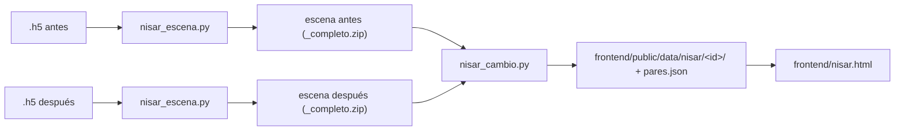

# Procesado NISAR: detección de cambios

Convierte pasadas de **NISAR L2 GCOV** (`.h5`, ~1,5 GB cada una) en los ficheros ligeros que pinta `frontend/nisar.html`: imágenes antes/después, capa de cambio, zonas de cambio con recortes a 20 m y estadísticas.



## Instalación

Python 3.10 o superior.

```bash
cd processing
python -m pip install -r requirements.txt
```

## Uso con datos reales

1. Descarga dos pasadas GCOV de la **misma pista, dirección y frame** (por ejemplo `..._032_083_D_091_...` y `..._033_083_D_091_...`) desde [ASF Vertex](https://search.asf.alaska.edu) o [Earthdata Search](https://search.earthdata.nasa.gov).
2. Convierte cada `.h5` en una escena. Lee la imagen entera a 20 m y la guarda troceada y cuantizada (paso de 0,2 dB):
   ```bash
   python nisar_escena.py C:\ruta\NISAR_..._20261005....h5 --salida escenas
   python nisar_escena.py C:\ruta\NISAR_..._20261017....h5 --salida escenas
   ```
3. Compara las dos y publica el resultado para la web:
   ```bash
   python nisar_cambio.py escenas/NISAR_..._20261005..._completo.zip escenas/NISAR_..._20261017..._completo.zip ^
       --id peru_oct2026 --titulo "Amazonía peruana · Marañón y Huallaga"
   ```
   Por defecto escribe en `../frontend/public/data/nisar/<id>/` y añade el par a `pares.json`.
4. Abre la web (ver abajo) y elige el par en el desplegable.

Las escenas generadas con el antiguo `analizar_nisar.py` también sirven.

## Método (`nisar_cambio.py`)

1. **Filtro de speckle**: media 5×5 en potencia lineal (ventana de 100 m).
2. **Diferencia** `d = dB_después − dB_antes`, píxel a píxel.
3. **Desplazamiento global**: se resta la mediana de `d`. Un cambio de humedad o de calibración entre fechas sube o baja toda la escena y no es un cambio local.
4. **Clases** (umbral `--umbral`, 3 dB por defecto; agua = brillo por debajo de `--agua`, −15 dB):

   | Clase | Regla | Lectura posible |
   | --- | --- | --- |
   | Agua nueva | no era agua, ahora sí, `d < −U` | inundación, crecida |
   | Agua que desaparece | era agua, ahora no, `d > +U` | retirada del agua, lago que mengua |
   | Descenso | `d < −U` | tala, cosecha, suelo más seco |
   | Aumento | `d > +U` | vegetación, obras, suelo más húmedo |
5. **Zonas**: la clase dominante por bloques de 80 m, agrupada en manchas conexas. Se descartan las menores de `--area-min` km² (0,05 por defecto). Las `--zonas` mayores (12) llevan recortes a 20 m.

## Salida (`frontend/public/data/nisar/`)

| Fichero | Contenido |
| --- | --- |
| `pares.json` | índice de pares para el desplegable |
| `<id>/cambio.json` | fechas, gránulos, `bounds` lat/lon para Leaflet, parámetros, estadísticas por clase, histograma del cambio y lista de zonas |
| `<id>/antes.webp`, `despues.webp` | fondo de radar en gris, misma escala para las dos fechas |
| `<id>/cambio.png` | capa de clases con fondo transparente (80 m) |
| `<id>/diferencia.webp` | diferencia en dB, azul = baja, rojo = sube |
| `<id>/zonas/zNNN_*.webp/png` | recortes de 10 km a 20 m: antes, después y cambio |

Las imágenes están en la cuadrícula UTM del producto y se colocan en Leaflet con su rectángulo lat/lon. En una escena de unos 300 km el giro entre las dos cuadrículas es de unas décimas de grado, así que el error es de pocos píxeles. Para una precisión mayor habría que reproyectar.

## Datos de prueba incluidos

- `peru_oct2026_simulado`: escena **real** del 5 oct 2026 (track 83, frame 91, Amazonía peruana) frente a un "después" **simulado** con `simular_despues.py`. Lleva un desplazamiento global de +0,8 dB, ruido independiente de 1,5 dB y seis cambios conocidos: una inundación, tres parcelas taladas, el lago que mengua y una zona que sube. Se detectan los seis, a 1 km o menos de su posición real y con un error de área inferior al 10 %. Fuera de ellos solo aparecen tres fragmentos diminutos (0,05–0,08 km²) en el borde de la inundación.
- `california_2008_muestra`: las dos muestras oficiales de 2008 (ALOS/PALSAR en formato NISAR, Antelope Valley). Son dos fechas reales. Toda la escena sube unos 4 dB, probablemente por humedad, y tras corregirlo destacan las zonas que suben menos (ciudades y lagos secos). En desierto el umbral de agua no vale, porque el suelo seco y liso es tan oscuro como el agua.

Para regenerar el par simulado:

```bash
python simular_despues.py escenas/antes_2026-10-05.zip --salida escenas/simulada_2026-10-17
python nisar_cambio.py escenas/antes_2026-10-05.zip escenas/simulada_2026-10-17.zip --id peru_oct2026_simulado --simulado
```

## Pruebas

```bash
python -m unittest discover -s processing/tests -v
```

Cubren la cuantización, el filtro, la conversión UTM→lat/lon y un caso completo con cambios inyectados en una escena sintética.

## Ver la web en local

```bash
cd frontend
python -m http.server 8000
```

Abre http://localhost:8000/nisar.html. Con `#california_2008_muestra` al final de la URL se abre directamente ese par.

## Límites conocidos

- Solo polarización HH. Si el `.h5` trae HV (pasadas DHDH), `nisar_escena.py` la guarda, pero `nisar_cambio.py` aún no la usa.
- Umbrales fijos. El de agua (−15 dB) falla en desiertos y en superficies de agua con viento.
- No hay corrección de pendiente ni de sombra de radar: en montaña aparecen falsos cambios.
- Las dos escenas tienen que compartir cuadrícula, lo que se cumple con la misma pista y el mismo frame. Si no, el script lo avisa y se detiene.
