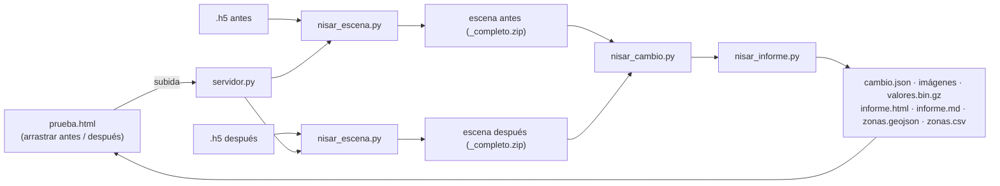

# Procesado NISAR: detección de cambios

Convierte pasadas de **NISAR L2 GCOV** (`.h5`, ~1,5 GB cada una) en los ficheros ligeros que pintan `frontend/nisar.html` y `frontend/prueba.html`: imágenes antes/después, capa de cambio, zonas con su contorno, estadísticas, una rejilla de valores para consultar con el ratón e informes (HTML, Markdown, GeoJSON y CSV).

Se puede usar de dos formas:

- **Con la web de pruebas** (`servidor.py` + `prueba.html`): arrastras el antes y el después y el servidor hace todo.
- **Por línea de comandos** (`nisar_escena.py` → `nisar_cambio.py` → `nisar_informe.py`).



## Web de pruebas (lo más rápido)

Desde la **raíz del repo**:

```bash
python -m pip install -r processing/requirements.txt
python processing/servidor.py
```

Abre **http://localhost:8001/prueba.html** (la página no tiene enlace en el menú: se entra por la URL).

1. Arrastra la pasada de **antes** a su cuadro y la de **después** al suyo (también puedes soltar las dos a la vez en cualquiera de los dos cuadros: se ordenan por fecha). Vale el `.h5` tal cual lo descargas de ASF o la escena `.zip` que genera `nisar_escena.py` (mucho más rápida).
2. La página lee el nombre del fichero y comprueba al momento que las dos pasadas son de la misma pista, el mismo frame y la misma dirección de órbita, y que las fechas están en orden.
3. Pulsa **Analizar cambios**. Verás el progreso de cada paso (convertir antes, convertir después, comparar, informes).
4. Al terminar aparece el resultado: mapa interactivo, zonas, gráficas, resumen en texto e informes descargables. Los análisis quedan guardados en `processing/trabajos/` y se pueden volver a abrir desde la propia página (`prueba.html#t=<id>`). Los ejemplos incluidos en el repo se abren sin servidor con `prueba.html#ej=<id>`.

Tiempos orientativos en un portátil: convertir un `.h5` de 1,5 GB, unos minutos; comparar dos escenas completas (16 000 × 16 700 px), unos 5 minutos. Hace falta ~3 GB de RAM libre y disco para las subidas (los `.h5` se borran tras convertirlos; usa `--conservar-h5` para guardarlos).

Opciones del servidor:

| Opción | Por defecto | Para qué |
| --- | --- | --- |
| `--puerto` | 8001 | puerto HTTP |
| `--host` | 127.0.0.1 | `0.0.0.0` lo abre a la red. **No tiene autenticación**: úsalo solo en una red de confianza o detrás de un proxy con login |
| `--datos` | `processing/trabajos` | dónde guarda subidas, escenas convertidas y resultados |
| `--limite-gb` | 4 | tamaño máximo por fichero |
| `--conservar-h5` | no | no borrar el `.h5` subido tras convertirlo |
| `--cors` | no | permitir que otra web llame a la API (p. ej. `prueba.html` servida por Caddy y el servidor en otro puerto: `prueba.html?api=http://host:8001`) |

API (JSON): `GET /api/nisar/estado`, `POST /api/nisar/subidas?nombre=F` (cuerpo = el fichero en crudo), `POST /api/nisar/trabajos` (`{antes, despues, umbral, agua, area_min, titulo}`), `GET /api/nisar/trabajos[/<id>]`. Los resultados se sirven en `/trabajos/<id>/`.

`Containerfile` (sin probar todavía) empaqueta el servidor y la web: `podman build -f processing/Containerfile -t nisar-procesado .` y `podman run -p 8001:8001 -v nisar_datos:/datos nisar-procesado`.

## Instalación

Python 3.10 o superior.

```bash
cd processing
python -m pip install -r requirements.txt
```

## Uso por línea de comandos

1. Descarga dos pasadas GCOV de la **misma pista, dirección y frame** (por ejemplo `..._032_083_D_091_...` y `..._033_083_D_091_...`) desde [ASF Vertex](https://search.asf.alaska.edu) o [Earthdata Search](https://search.earthdata.nasa.gov).
2. Convierte cada `.h5` en una escena. Lee la imagen entera a 20 m y la guarda troceada y cuantizada (paso de 0,2 dB):
   ```bash
   python nisar_escena.py C:\ruta\NISAR_..._20261005....h5 --salida escenas
   python nisar_escena.py C:\ruta\NISAR_..._20261017....h5 --salida escenas
   ```
3. Compara las dos y publica el resultado para la web:
   ```bash
   python nisar_cambio.py escenas/NISAR_..._20261005..._completo.zip escenas/NISAR_..._20261017..._completo.zip ^
       --id peru_oct2026 --titulo "Amazonía peruana · Marañón y Huallaga"
   ```
   Por defecto escribe en `../frontend/public/data/nisar/<id>/` y añade el par a `pares.json`.
4. Genera los informes del par:
   ```bash
   python nisar_informe.py ../frontend/public/data/nisar/peru_oct2026
   ```
5. Abre la web (ver abajo) y elige el par en el desplegable de `nisar.html`, o ábrelo en `prueba.html#ej=peru_oct2026`.

Las escenas generadas con el antiguo `analizar_nisar.py` también sirven.

## Método (`nisar_cambio.py`)

1. **Filtro de speckle**: media 5×5 en potencia lineal (ventana de 100 m).
2. **Diferencia** `d = dB_después − dB_antes`, píxel a píxel.
3. **Desplazamiento global**: se resta la mediana de `d`. Un cambio de humedad o de calibración entre fechas sube o baja toda la escena y no es un cambio local.
4. **Clases** (umbral `--umbral`, 3 dB por defecto; agua = brillo por debajo de `--agua`, −15 dB):

   | Clase | Regla | Lectura posible |
   | --- | --- | --- |
   | Agua nueva | no era agua, ahora sí, `d < −U` | inundación, crecida |
   | Agua que desaparece | era agua, ahora no, `d > +U` | retirada del agua, lago que mengua |
   | Descenso | `d < −U` | tala, cosecha, suelo más seco |
   | Aumento | `d > +U` | vegetación, obras, suelo más húmedo |
5. **Zonas**: la clase dominante por bloques de 80 m, agrupada en manchas conexas. Se descartan las menores de `--area-min` km² (0,05 por defecto). De cada zona se guarda su contorno real (bordes de los bloques, simplificado), brillo medio antes y después, cambio medio y extremo, porcentaje de agua, tipo de superficie, perímetro, compacidad y una **confianza** (alta: ≥ 0,5 km² y |Δ| ≥ 2U; media: ≥ 0,1 km² y |Δ| ≥ 1,25U; baja: el resto). Las `--zonas` mayores (12) llevan recortes a 20 m.
6. **Información de toda la escena**: histogramas de brillo de cada fecha y del cambio, percentiles del cambio, correlación entre fechas, balance de agua y una **matriz de "coberturas radar"** (agua < −15 dB ≤ liso < −9 dB ≤ vegetación < −3 dB ≤ muy brillante) que dice en qué se convierte cada superficie. Es una lectura aproximada del brillo, no un mapa de usos del suelo.
7. **Resumen en texto**: párrafos en lenguaje llano (`resumen_texto`) que usan la web y el informe.

## Salida (`frontend/public/data/nisar/`)

| Fichero | Contenido |
| --- | --- |
| `pares.json` | índice de pares para el desplegable |
| `<id>/cambio.json` | fechas, gránulos, `bounds` lat/lon para Leaflet, parámetros, estadísticas, histogramas, matriz de coberturas, balance de agua, resumen en texto y lista de zonas (hasta 500, con contorno) |
| `<id>/antes.webp`, `despues.webp` | fondo de radar en gris, misma escala para las dos fechas |
| `<id>/cambio.png` | capa de clases con fondo transparente (80 m) |
| `<id>/diferencia.webp` | diferencia en dB, azul = baja, rojo = sube |
| `<id>/densidad.png` | % de píxeles con cambio por celda de 320 m (dónde se concentra) |
| `<id>/valores.bin.gz` | rejilla de 320 m con brillo antes/después, cambio, % de cambio y clase, para leer valores con el ratón |
| `<id>/zonas/zNNN_*.webp/png` | recortes de 10 km a 20 m: antes, después y cambio |
| `<id>/informe.html`, `informe.md` | informe imprimible (guárdalo como PDF desde el navegador) y su versión Markdown |
| `<id>/zonas.geojson`, `zonas.csv` | zonas con todos sus datos para QGIS, Google Earth o Excel |

Las imágenes están en la cuadrícula UTM del producto y se colocan en Leaflet con su rectángulo lat/lon. En una escena de unos 300 km el giro entre las dos cuadrículas es de unas décimas de grado, así que el error es de pocos píxeles. Para una precisión mayor habría que reproyectar.

## Datos de prueba incluidos

- `peru_oct2026_simulado`: escena **real** del 5 oct 2026 (track 83, frame 91, Amazonía peruana) frente a un "después" **simulado** con `simular_despues.py`. Lleva un desplazamiento global de +0,8 dB, ruido independiente de 1,5 dB y seis cambios conocidos: una inundación, tres parcelas taladas, el lago que mengua y una zona que sube. Se detectan los seis, a 1 km o menos de su posición real y con un error de área inferior al 10 %. Fuera de ellos solo aparecen tres fragmentos diminutos (0,05–0,08 km²) en el borde de la inundación.
- `california_2008_muestra`: las dos muestras oficiales de 2008 (ALOS/PALSAR en formato NISAR, Antelope Valley). Son dos fechas reales. Toda la escena sube unos 4 dB, probablemente por humedad, y tras corregirlo destacan las zonas que suben menos (ciudades y lagos secos). En desierto el umbral de agua no vale, porque el suelo seco y liso es tan oscuro como el agua.

Para regenerar el par simulado:

```bash
python simular_despues.py escenas/antes_2026-10-05.zip --salida escenas/simulada_2026-10-17
python nisar_cambio.py escenas/antes_2026-10-05.zip escenas/simulada_2026-10-17.zip --id peru_oct2026_simulado --simulado
```

## Pruebas

```bash
python -m unittest discover -s processing/tests -v
```

Cubren la cuantización, el filtro, la conversión UTM→lat/lon, los contornos, la lectura del nombre de los ficheros NISAR y un caso completo (cambio + informes) con cambios inyectados en una escena sintética.

## Ver la web en local

```bash
cd frontend
python -m http.server 8000
```

Abre http://localhost:8000/nisar.html. Con `#california_2008_muestra` al final de la URL se abre directamente ese par. Los ejemplos también se ven en http://localhost:8000/prueba.html#ej=california_2008_muestra (sin servidor de procesado no se puede subir nada nuevo).

## Límites conocidos

- Solo polarización HH. Si el `.h5` trae HV (pasadas DHDH), `nisar_escena.py` la guarda, pero `nisar_cambio.py` aún no la usa.
- Umbrales fijos. El de agua (−15 dB) falla en desiertos y en superficies de agua con viento.
- No hay corrección de pendiente ni de sombra de radar: en montaña aparecen falsos cambios.
- Las dos escenas tienen que compartir cuadrícula, lo que se cumple con la misma pista y el mismo frame. Si no, el script lo avisa y se detiene.
